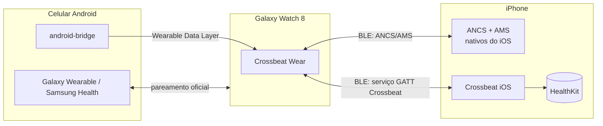

# Crossbeat

> *Cross-platform* + *heartbeat*: dois sistemas, um pulso.

Crossbeat é um projeto open source para usar um **Galaxy Watch 8 (Wear OS 6)** com **iPhone e Android ao mesmo tempo**.

O relógio continua pareado normalmente com o Android (Galaxy Wearable + Samsung Health) e, em paralelo, mantém uma conexão Bluetooth Low Energy (BLE) com o iPhone. Pelo iPhone, ele recebe notificações, controla chamadas e música e sincroniza dados de saúde com o Apple Health.

> **Status:** estágio inicial. Ainda não há código funcional; o primeiro passo é validar a conexão dupla no hardware.

## Por que existe

A Samsung só oferece suporte ao iPhone nos Galaxy Watch antigos com Tizen (Watch, Active, Active2, Watch3). Do Watch4 em diante, com Wear OS, não há suporte oficial a iOS. Já existem alternativas, como o Merge (pago) e o LibreWear (open source, sem app iOS ainda). Nenhuma delas tem o diferencial do Crossbeat: **manter o relógio pareado com o Android e, ao mesmo tempo, útil com o iPhone**.

## Objetivo: paridade com o Merge, mais conexão dupla

| Recurso | Como |
|---|---|
| Notificações do iPhone no relógio | ANCS (nativo do iOS) |
| Atender/recusar chamada | ANCS (ações positiva/negativa) |
| Controle de música | AMS (nativo do iOS) |
| FC, passos, calorias, distância → Apple Health | Health Services → app iOS → HealthKit |
| Sono, SpO2, treinos do Samsung Health → Apple Health | android-bridge → relógio → app iOS |
| Buscar aparelho, câmera, contatos, filtros por app | Serviço GATT do Crossbeat |

## Como funciona (resumo)



Detalhes em [docs/arquitetura.md](docs/arquitetura.md).

## Estrutura do repositório (monorepo)

```
crossbeat/
├── wear/             App Wear OS (Kotlin + Compose): o coração do projeto
├── ios/              App iOS (Swift + SwiftUI): HealthKit e recursos extras
├── android-bridge/   App Android (Kotlin): lê o Samsung Health Data SDK
├── protocol/         Protocolo do serviço GATT do Crossbeat (protobuf + framing)
└── docs/             Documentação, ADRs e specs
```

## Documentação

- [Visão geral](docs/visao-geral.md): o problema, o objetivo e o que está fora de escopo
- [Arquitetura](docs/arquitetura.md): componentes, conexões e fluxos
- [Protocolo](docs/protocolo.md): serviço GATT do Crossbeat e framing
- [Dados de saúde](docs/saude.md): de onde vem cada dado e como chega ao Apple Health
- [Ambiente de desenvolvimento](docs/desenvolvimento.md): Android Studio, ADB por Wi-Fi e Xcode
- [Referências](docs/referencias.md): especificações da Apple, SDKs e projetos estudados
- [Decisões (ADRs)](docs/adr/)
- [Specs](docs/specs/): o desenvolvimento é spec-first

## Princípios

- **Só apps do Crossbeat** rodam no relógio e nos celulares. Merge, LibreWear e WearBridge servem apenas de referência de estudo.
- **Sem servidor.** O relógio é o hub entre Android e iPhone.
- **Spec-first.** Toda funcionalidade começa por uma spec em `docs/specs/`.
- **Riscos primeiro.** Hipóteses técnicas arriscadas são validadas em protótipos descartáveis antes de virar produto.

## Licença

[MIT](LICENSE)
