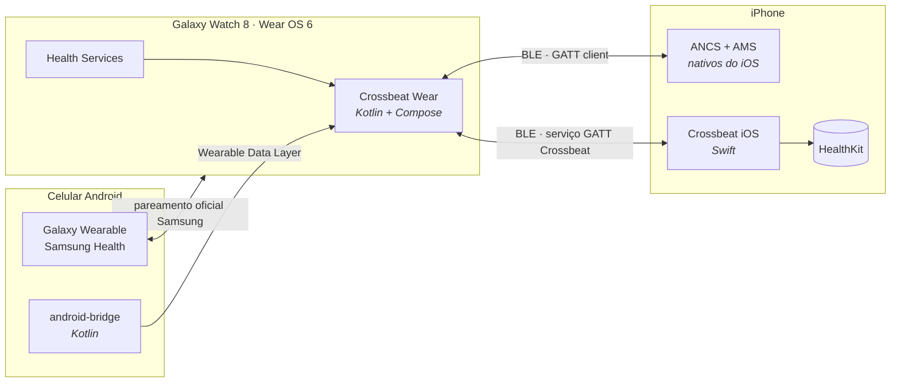
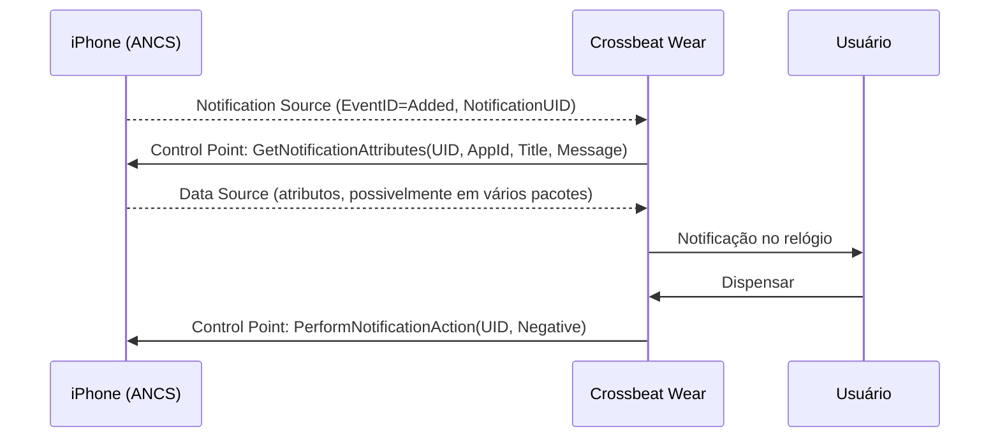
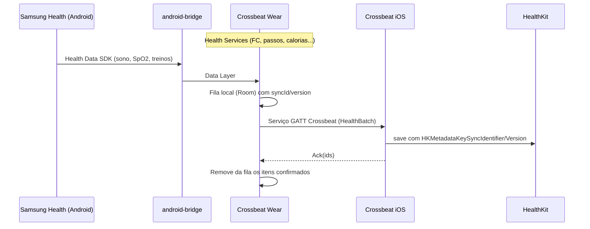

# Arquitetura

## Visão de dispositivos

Três dispositivos e três apps do Crossbeat. O relógio é o hub e não existe servidor.

### Duas conexões Bluetooth no relógio

| Conexão | Dono | Pra quê |
|---|---|---|
| Relógio ↔ Android | Sistema (Galaxy Wearable) | Pareamento oficial, Samsung Health, LTE, firmware, Data Layer |
| Relógio ↔ iPhone | Crossbeat Wear | ANCS, AMS e o serviço GATT do Crossbeat |

A conexão com o iPhone é uma conexão BLE extra, gerenciada pelo nosso app. Ela não substitui nem interfere no pareamento oficial. **Essa é a principal hipótese técnica do projeto e a primeira coisa a ser validada no hardware.**

## Componentes

### `wear/`: Crossbeat Wear (Kotlin + Compose)

O coração do projeto. Responsabilidades:

- **Link BLE com o iPhone:** bond, reconexão automática e sobrevivência a reboot (foreground service + receiver de boot).
- **Cliente ANCS:** assina o Notification Source, busca atributos pelo Control Point/Data Source e executa ações positivas e negativas.
- **Cliente AMS:** assina o Entity Update (faixa, artista, estado do player) e envia comandos pelo Remote Command.
- **UI:** notificações do Wear OS para os alertas do iPhone, overlay de chamada (atender/recusar), tile e tela de mídia.
- **Saúde:** Health Services (`PassiveMonitoringClient` e `ExerciseClient`) e o recebimento dos dados do android-bridge pelo Data Layer.
- **Cliente do serviço GATT do Crossbeat:** envia os dados de saúde e os comandos para o app iOS.

### `ios/`: Crossbeat iOS (Swift + SwiftUI)

Só é necessário para o que o iOS não expõe por BLE:

- Gravação no **HealthKit** (com deduplicação; ver [saude.md](saude.md)).
- Buscar aparelho (tocar som no iPhone), controle da câmera, contatos e filtros de notificação por app.
- Expõe o **serviço GATT do Crossbeat** pelo `CBPeripheralManager`.
- Funciona em background: background mode `bluetooth-peripheral` (e `bluetooth-central`, se necessário) com **state restoration**.
- A interface é pequena: status da conexão, permissões, filtros e histórico de sincronização.

Por que nativo, e não React Native: quase tudo aqui é BLE em background e HealthKit. Ver [ADR 0003](adr/0003-apps-nativos.md).

### `android-bridge/`: Crossbeat Bridge (Kotlin)

Existe porque alguns dados de saúde **não estão disponíveis para apps de terceiros no relógio**: estágios e score do sono, SpO2, temperatura da pele e treinos registrados pelo Samsung Health.

- Lê os dados pelo **Samsung Health Data SDK** (Android).
- Envia ao relógio pela **Wearable Data Layer API** (`DataClient`/`MessageClient`).
- Roda com WorkManager, com sincronização incremental por data da última leitura.

### `protocol/`

Definição do serviço GATT do Crossbeat: UUIDs, framing com chunking pelo MTU e mensagens protobuf versionadas. É a fonte da verdade compartilhada entre `wear/` e `ios/`. Ver [protocolo.md](protocolo.md).

## Fluxos

### Notificação do iPhone no relógio

### Chamada recebida

1. O ANCS envia uma notificação com `CategoryID = IncomingCall`.
2. O relógio mostra o overlay de chamada em tela cheia.
3. Atender gera `PerformNotificationAction(Positive)`; recusar gera `Negative`.
4. O áudio continua no iPhone.

### Música

1. O relógio assina o Entity Update com os atributos do Player (nome, estado e volume) e da Track (artista, título, duração).
2. O relógio escreve no Remote Command (Play, Pause, TogglePlayPause, NextTrack, PreviousTrack, VolumeUp, VolumeDown).

### Saúde

O relógio mantém uma **fila persistente**: dados que chegam enquanto o iPhone está fora de alcance são enviados depois. O iOS confirma cada lote, e só então o item sai da fila.

## Questão em aberto: quem inicia a conexão com o iPhone

Os papéis de **GATT** (cliente/servidor) são independentes dos papéis de **enlace** (central/peripheral). O relógio sempre é **GATT client** do ANCS e do AMS. O que está em aberto é quem inicia a conexão:

| Opção | Como funciona | Implicação |
|---|---|---|
| **A. Relógio como peripheral** | O relógio anuncia com *service solicitation* do ANCS; o iPhone conecta e faz o bond | Padrão usado por acessórios ANCS. Exige que algo no iPhone inicie a conexão: o app Crossbeat iOS ou, em testes, uma ferramenta como nRF Connect/LightBlue |
| **B. Relógio como central** | O relógio escaneia e conecta no iPhone | O iPhone não anuncia sozinho; só anuncia se houver um app em modo peripheral (o próprio Crossbeat iOS) |

Nas duas opções, é provável que **mesmo o MVP precise de um app iOS mínimo** para estabelecer e manter o link (reconexão em background, state restoration). As notificações e a música continuam vindo do ANCS e do AMS, sem lógica no app iOS. A escolha entre A e B depende de testes no hardware e será registrada numa ADR.

## Persistência

| Onde | O quê |
|---|---|
| Relógio (Room/DataStore) | Bond e identificador do iPhone, filtros por app, fila de saúde, último sync |
| iOS (UserDefaults/SwiftData) | Configurações, histórico de sync |
| Android bridge (DataStore) | Marca d'água da última leitura por tipo de dado |

## Segurança e privacidade

- Toda comunicação relógio ↔ iPhone ocorre num link BLE **criptografado após o bond**. O ANCS exige isso.
- Dados de saúde **nunca saem dos dispositivos do usuário**: não há servidor nem telemetria.
- Permissões são pedidas sob demanda, com explicação na tela.
