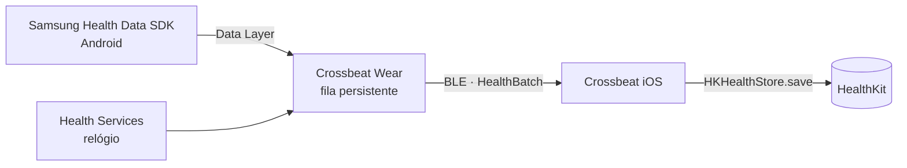

# Dados de saúde

## De onde vem cada dado

| Fonte | Onde roda | O que dá | Limitações |
|---|---|---|---|
| Health Services: `PassiveMonitoringClient` | Relógio | Frequência cardíaca, passos, calorias, distância, andares | Os dados chegam em lote, em intervalos imprevisíveis |
| Health Services: `ExerciseClient` | Relógio | Treinos com métricas em tempo real | Só para treinos iniciados pelo **nosso** app |
| Samsung Health Data SDK | **Android** | Sono (estágios, score), SpO2, temperatura da pele, treinos do Samsung Health, passos etc. | Para testar, é preciso ativar o "Developer Mode for Data Read". Para distribuir, é preciso aprovação da Samsung |

> **Os estágios de sono não estão disponíveis no relógio para apps de terceiros.** Eles só podem ser lidos pelo Android, com o Samsung Health Data SDK. Por isso existe o `android-bridge`.

## Caminho até o Apple Health

**Alternativa considerada:** usar um relay pelo homelab (Android → servidor → iOS). Foi descartada por enquanto para manter o princípio de não ter servidor. Ver [ADR 0004](adr/0004-relogio-como-hub.md).

## Mapeamento para HealthKit

| Crossbeat | HealthKit |
|---|---|
| `HEART_RATE` | `HKQuantityType(.heartRate)` |
| `STEPS` | `HKQuantityType(.stepCount)` |
| `ACTIVE_CALORIES` | `HKQuantityType(.activeEnergyBurned)` |
| `DISTANCE` | `HKQuantityType(.distanceWalkingRunning)` |
| `FLOORS` | `HKQuantityType(.flightsClimbed)` |
| `SPO2` | `HKQuantityType(.oxygenSaturation)` |
| `SLEEP_STAGE` | `HKCategoryType(.sleepAnalysis)` (core, deep, REM, awake) |
| Treinos | `HKWorkout` + amostras associadas |

## Deduplicação

O mesmo dado pode chegar mais de uma vez (reenvio após queda de conexão, por exemplo). Cada amostra carrega:

- `HKMetadataKeySyncIdentifier`: `sync_id` estável, derivado de fonte + tipo + início + fim.
- `HKMetadataKeySyncVersion`: incrementado quando o dado de origem muda (o Samsung Health às vezes reprocessa o sono, por exemplo).

Com esses dois metadados, o HealthKit substitui a amostra anterior em vez de duplicar.

**Passos e calorias** podem vir tanto do Health Services quanto do Samsung Health. A regra inicial é usar **uma única fonte por tipo**, configurável no app, para não contar em dobro.

## Permissões

- **Relógio (Wear OS 6 / Android 16):** permissões granulares de saúde, como `android.permission.health.READ_HEART_RATE`, mais a permissão de leitura em background. Ainda precisa ser validado no Wear OS 6.
- **iOS:** autorização de escrita no HealthKit, tipo por tipo.
- **Android:** permissões do Samsung Health Data SDK, concedidas no próprio Samsung Health.
